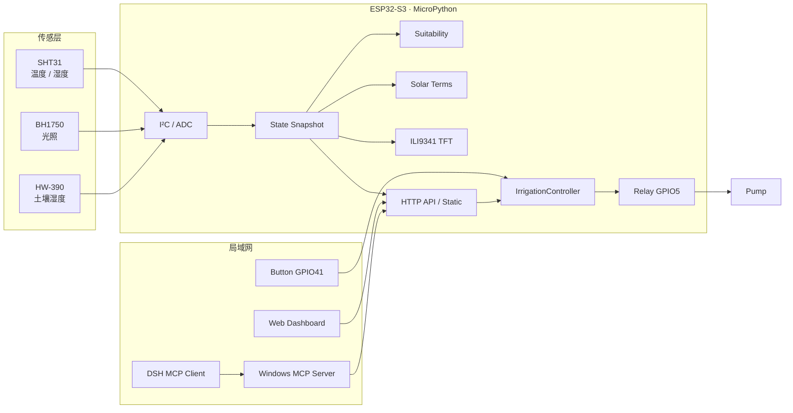
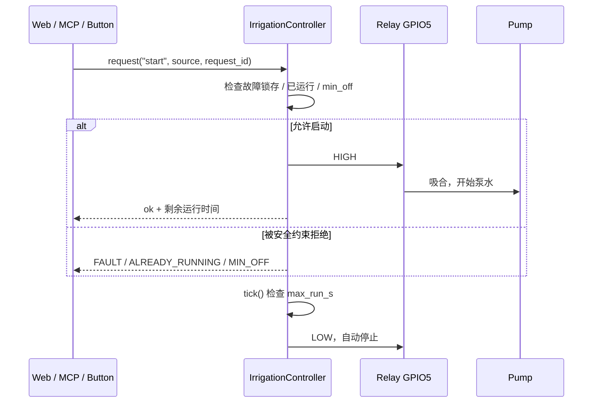

<p align="center">
  
  &nbsp;&nbsp;
  
  <br>
  <sub>Open Source Hardware · 非 OSHWA 认证 &nbsp;|&nbsp; Open Source Software · MIT</sub>
</p>

# SolarTerm Farm · 节气智农

> 一个运行在 **ESP32-S3 N16R8 + MicroPython** 上的智能农业垂直切片：环境采集、植物适宜度、节气农事、安全灌溉、本地 TFT、局域网 Web 与 Windows MCP。

`ESP32-S3` · `MicroPython 1.29` · `ILI9341 TFT` · `LAN only` · `75 host tests` · `MCP ready` · `Open Hardware` · `MIT + CERN-OHL-S` · `v0.1.0`

SolarTerm Farm（节气智农，智能节气种植箱）面向小型种植箱、阳台菜园和教学演示。设备在**无云、无互联网**的局域网中独立运行；Web、TFT、按钮和 MCP 都只是状态消费者或意图源，水泵安全始终由设备端 `IrrigationController` 最终裁决。

> **项目阶段：M1 垂直切片。** 固件、Web、TFT、MCP 和测试链路已打通，正在做真机 bring-up。TFT 方向、闪烁和泵启动时的电源干扰仍在验证。

---

## 目录

- [项目亮点](#项目亮点)
- [项目图库](#项目图库)
- [系统架构](#系统架构)
- [硬件清单](#硬件清单)
- [引脚分配](#引脚分配)
- [Open Hardware](#open-hardware)
- [灌溉安全模型](#灌溉安全模型)
- [快速开始](#快速开始)
- [固件部署](#固件部署)
- [Wi-Fi 配置](#wi-fi-配置)
- [Web 管理页](#web-管理页)
- [MCP Server](#mcp-server)
- [HTTP API](#http-api)
- [测试](#测试)
- [目录结构](#目录结构)
- [路线图](#路线图)
- [已知限制](#已知限制)
- [安全与隐私](#安全与隐私)
- [贡献](#贡献)
- [许可证](#许可证)
- [文档索引](#文档索引)

---

## 项目亮点

| 能力 | 实现 |
|---|---|
| 环境感知 | SHT31 空气温湿度、BH1750 光照、HW-390 电容式土壤湿度 |
| 植物适宜度 | 土壤、温度、湿度、光照四因子加权评分，支持植物档案、生长阶段与自定义权重 |
| 节气农事 | 24 节气太阳黄经计算，节气名称、日期、季节、农事建议与习俗内容 |
| 安全灌溉 | 自动/手动模式、最大运行时间、最小停泵时间、故障锁存、请求幂等 |
| 本地交互 | 2.8 英寸 ILI9341 SPI TFT 常亮仪表盘；GPIO41 按钮启停水泵 |
| 局域网 Web | 六页管理界面，实时状态、趋势图、参数保存、土壤两点标定、植物档案导入 |
| MCP | Windows 端 stdio MCP Server，读传感器/状态，可选启停泵与参数控制 |
| 可测试性 | 主机模拟器 + 75 项标准库 unittest，不依赖真实硬件即可开发 |

**不依赖云服务。** 设备、Web 和 MCP 均在同一局域网内工作；电脑休眠时 MCP 不可用，但设备本地灌溉与 Web 不受影响。

---

## 项目图库

> 以下为**图片占位**。上传真实照片后，把对应文字块替换为 Markdown 图片即可。建议统一放在 `docs/images/`，文件名已给出。

> **图片占位 01 · 项目总览**
>
> - 建议文件：`docs/images/01-overview.jpg`
> - 画面：桌面上的 SolarTerm Farm 设备、TFT、按钮、继电器、水泵与接线整体。
> - 替换：``

> **图片占位 02 · TFT 仪表盘特写**
>
> - 建议文件：`docs/images/02-tft-dashboard.jpg`
> - 画面：竖屏 TFT 正视图，能读到 `AIR TEMP`、`SOIL`、`PUMP`、`SOLAR TERM`。
> - 替换：``

> **图片占位 03 · Web 管理页**
>
> - 建议文件：`docs/images/03-web-dashboard.png`
> - 画面：桌面浏览器的总览页，含环境曲线、节气卡片和设备状态。
> - 替换：``

> **图片占位 04 · 接线与执行器**
>
> - 建议文件：`docs/images/04-wiring.jpg`
> - 画面：ESP32-S3、TFT、传感器、继电器、水泵电源的接线与共地。
> - 替换：``

> **图片占位 05 · MCP 客户端**
>
> - 建议文件：`docs/images/05-mcp-client.png`
> - 画面：DSH 或 MCP 客户端中调用 `mcp__agriverse__get_environment`、`get_irrigation_status`。
> - 替换：``

> **图片占位 06 · 灌溉测试**
>
> - 建议文件：`docs/images/06-irrigation-test.jpg`
> - 画面：水泵出水、继电器动作或按钮启停的测试记录。
> - 替换：``

图片占位清单也维护在 [`docs/images/README.md`](docs/images/README.md)。

---

## 系统架构



### 一次灌溉请求如何被裁决



---

## 硬件清单

| 部件 | 型号 / 规格 | 说明 |
|---|---|---|
| 主控 | ESP32-S3 N16R8 | 16 MB Flash / 8 MB PSRAM，USB 串口 |
| 本地显示 | 2.8 英寸 240×320 ILI9341 | SPI，7 针，无触摸，常亮 |
| 按钮 | 常开按钮 | GPIO41，高电平触发，内部下拉 |
| 空气温湿度 | SHT31 | I²C，3.3V |
| 光照 | BH1750 | I²C，3.3V，与 SHT31 共用总线 |
| 土壤湿度 | HW-390 V2.0 | 电容式，模拟输出接 ADC |
| 执行器 | 3.3V 高电平触发继电器 | IN=GPIO5，COM/NO 接水泵 |
| 水泵 | 低压直流水泵 | 独立电源，继电器低压侧控制 |
| 水位检测 | 不安装 | 系统不提供缺水自动检测 |

> **电源建议：** 水泵和继电器属于感性负载，建议独立供电、共地、加续流二极管与滤波电容。不要把水泵电流经过 ESP32 的 3.3V 稳压器。

---

## 引脚分配

| GPIO | 连接 | 模式 | 备注 |
|---:|---|---|---|
| 1 | TFT CS | 输出 | 片选 |
| 2 | TFT DC | 输出 | 数据/命令 |
| 4 | 土壤 AOUT | ADC | HW-390 模拟量 |
| 5 | 继电器 IN | 输出 | HIGH 泵运行，LOW 停止 |
| 8 | SHT31 / BH1750 SDA | I²C | 3.3V 上拉 |
| 9 | SHT31 / BH1750 SCL | I²C | 3.3V 上拉 |
| 38 | TFT RST | 输出 | 复位 |
| 39 | TFT SDA / MOSI | SPI | 不是 I²C SDA |
| 40 | TFT SCK | SPI | 时钟 |
| 41 | 按钮 OUT | 输入 | 高电平按下，内部下拉 |

**不要使用 GPIO36/37。** N16R8 的 PSRAM 引脚组包含 GPIO35–37；TFT 的 CS/DC 已避开这些引脚。

完整接线、继电器 COM/NO 与传感器总线排查见 [docs/GPIO_WIRING.md](docs/GPIO_WIRING.md)。

---

## Open Hardware

SolarTerm Farm 同时以 **open source hardware** 方式发布：

| 对象 | 许可证 |
|---|---|
| 硬件设计文档、BOM、接线、装配 | [CERN-OHL-S-2.0](LICENSE-HARDWARE) |
| 固件、Web、工具、测试 | [MIT](LICENSE) |
| 第三方模块 | 各自厂商条款 |

- 物料清单：[hardware/BOM.csv](hardware/BOM.csv)
- 模块级原理图：[hardware/SCHEMATIC.svg](hardware/SCHEMATIC.svg)
- 装配布局图：[hardware/ASSEMBLY.svg](hardware/ASSEMBLY.svg)
- 接线与装配：[hardware/WIRING.md](hardware/WIRING.md)
- 第三方 datasheet：[hardware/DATASHEETS.md](hardware/DATASHEETS.md)
- 完整合规说明：[docs/OPEN_HARDWARE.md](docs/OPEN_HARDWARE.md)

当前是 **module-level build**（现成模块 + 接线 + 固件），不是定制 PCB。仓库提供 BOM、原理图、装配图、接线、固件和测试；当前公开版本为 `v0.1.0`，尚未申请 OSHWA 认证，也没有 OSHWA UID，因此不会声称“OSHW certified”。

---

## 灌溉安全模型

SolarTerm Farm 把“谁想启动泵”和“泵是否允许运行”分开。

- `IrrigationController` 是唯一能操作继电器的地方；
- Web、MCP、按钮只能提交 `start` / `stop` 意图；
- 启动检查：故障锁存、已运行、`min_off_s`；
- 运行检查：`max_run_s` 到时自动停止；
- 控制请求必须带 `request_id`，60 秒内幂等；
- `stop` 始终可用，不被最小运行时间阻挡。

### GPIO5 继电器约定

```text
GPIO5 = 3.3V HIGH  → 继电器吸合 → 水泵运行
GPIO5 = 0V LOW     → 继电器释放 → 水泵停止
```

上电、复位、GPIO 高阻期间必须保持 LOW。继电器 IN 需要硬件下拉，水泵回路使用 **COM/NO 常开触点**。软件初始化只是第二道保险。

### 按钮行为

```text
泵停止 → 按一次 → 启动
泵运行 → 按一次 → 停止
停泵后 5 秒内再按 → 启动排队到 min_off_s 结束
不按停止 → 20 秒 max_run 自动停止
```

按钮不直接写 GPIO5，仍经过 `IrrigationController`。

---

## 快速开始

### 1. 无硬件运行 Web 模拟器

需要 Windows 10/11 + Python 3.11+，只依赖标准库。

```bat
tools\start.bat
```

或：

```bat
python tools\build_web.py
python tools\devserver.py --port 8080 --open
```

打开 `http://127.0.0.1:8080/`。页面顶部会显示“开发模拟器”，数据不是真实设备读数。

### 2. 运行测试

```bat
python -m unittest discover -s tests -v
```

预期：

```text
Ran 75 tests in ...
OK
```

也可以：

```bat
python tools\run_tests.py
```

### 3. 安装部署工具

```bat
tools\install.bat
```

安装 `mpremote` / `esptool`。只运行模拟器时不需要。

---

## 固件部署

### 前置条件

- ESP32-S3 已烧录 MicroPython 1.29 或兼容版本；
- 串口驱动正常，设备管理器中能看到 COM 口；
- 已运行 `tools\install.bat`；
- TFT、传感器和继电器按 [docs/GPIO_WIRING.md](docs/GPIO_WIRING.md) 接线。

### 部署

```bat
python tools\deploy.py --port COM11
```

脚本会：

1. 构建 `ESP/web/static/`；
2. 把 `ESP/` 下的 `.py` 上传到板端根目录；
3. 把 Web 静态文件写入 `/web/static`；
4. 复位设备。

`ESP/boot.py` 会在启动后调用 `main.main()`，避免复位后停在 REPL。

### 只检查将要上传的文件

```bat
python tools\deploy.py --port COM11 --dry-run
```

---

## Wi-Fi 配置

ESP32-S3 只支持 **2.4GHz**。5GHz 热点无法连接。

### 方式 A：本地代码配置（推荐开发时）

公开仓库只有占位文件：

```text
ESP/wifi_secrets.example.py
```

复制为本地文件：

```bat
copy ESP\wifi_secrets.example.py ESP\wifi_secrets.py
```

在本地填写：

```python
WIFI_SSID = "wifi_ssid"
WIFI_PASSWORD = "password"
```

`ESP/wifi_secrets.py` 已被 `.gitignore` 忽略，**禁止提交真实值**。

### 方式 B：串口配网

```bat
python tools\provision_wifi.py --port COM11
```

脚本用隐藏输入读取密码，写入 `/data/wifi.json`，复位并等待设备输出 IP。密码不会打印到终端，也不会进入聊天记录。

加载顺序：

```text
/data/wifi.json 存在 → 使用已保存凭据
否则 → 回退到 ESP/wifi_secrets.py
```

---

## Web 管理页

设备启动后访问：

```text
http://<device-ip>/
```

主要页面：

- **总览**：环境值、适宜度、节气、今日农事、设备状态
- **环境**：温度/湿度/土壤/光照趋势
- **灌溉**：模式、阈值、最大运行时间、手动启停
- **节气**：24 节气切换与农事内容
- **设置**：植物档案、生长阶段、权重、土壤两点标定
- **设备**：网络、版本、TFT/按钮配置

前端源文件在仓库根目录：

```text
agriverse_admin_dashboard.html
app.js
app.css
```

`ESP/web/static/` 是构建产物，不手工编辑。

---

## MCP Server

MCP Server 运行在同一局域网的 Windows 电脑上，通过 stdio 连接 DSH 或其他 MCP 客户端。

### 安装

```powershell
cd mcp_server
.\install.ps1
```

### 运行

```powershell
$env:AGRI_BASE_URL = "http://<device-ip>"
$env:AGRI_ALLOW_CONTROL = "1"
.\.venv\Scripts\python.exe -m agriverse_mcp
```

### 安全默认值

- 默认**只读**；
- 只有 `AGRI_ALLOW_CONTROL=1` 才注册启泵、阈值、模式和档案工具；
- `start_irrigation` 必须传 `confirm="START_IRRIGATION"`；
- `stop_irrigation` 始终可用；
- 泵运行时长仍由设备 `max_run_s` 强制限制；
- PIN 只从 `AGRI_PIN` 环境变量读取，不写日志。

DSH 配置后工具名为 `mcp__agriverse__*`。详见 [mcp_server/README.md](mcp_server/README.md) 与 [docs/MCP.md](docs/MCP.md)。

---

## HTTP API

基础路径：`/api/v1`

| 方法 | 路径 | 用途 |
|---|---|---|
| GET | `/state` | 传感器、适宜度、节气、灌溉、网络、配置快照 |
| GET | `/history?range=12h\|24h\|7d` | 历史点 |
| GET | `/solar-terms` | 24 节气元数据 |
| GET | `/plant-profiles` | 内置与导入植物档案 |
| POST | `/plant-profiles/import` | 导入植物档案 |
| GET | `/config` | 公开配置 |
| PUT | `/config` | 保存灌溉/植物/标定/TFT/按钮参数 |
| POST | `/irrigation/commands` | `start` / `stop` |
| POST | `/time` | 浏览器校时 |
| GET | `/health` | 轻量探活 |

控制请求需要 `request_id`；启用 PIN 时还需要 `X-AgriVerse-Pin`。

详见 [docs/API.md](docs/API.md)。

---

## 测试

```text
tests/
├─ test_api.py
├─ test_button.py
├─ test_config.py
├─ test_irrigation.py
├─ test_network.py
├─ test_solar_terms.py
├─ test_tft.py
└─ ...
```

覆盖范围：

- HTTP 解析与真实 socket 往返
- API envelope、参数校验、错误码
- 灌溉状态机与请求幂等
- 土壤两点标定
- SHT31 CRC 与数据解码
- 节气黄经/边界
- 植物档案导入与阶段权重
- Wi-Fi 配网状态机
- TFT 格式化与按钮意图

MCP 测试：

```powershell
cd mcp_server
.\.venv\Scripts\python.exe -m unittest discover -s tests -v
```

---

## 目录结构

```text
SolarTerm Farm/
├─ agriverse_admin_dashboard.html   # Web UI 视觉源文件
├─ app.js                           # 前端数据层
├─ app.css                          # 前端样式
├─ ESP/                             # MicroPython 固件
│  ├─ boot.py                       # 启动 main.main()
│  ├─ main.py                       # 组合根与异步任务
│  ├─ config.py                     # 默认配置与校验
│  ├─ button.py                     # GPIO41 启停意图
│  ├─ tft/                          # ILI9341 驱动与仪表盘
│  ├─ sensors/                      # 土壤 / SHT31 / BH1750 / I²C 恢复
│  ├─ suitability/                  # 适宜度模型与植物档案
│  ├─ solar_terms/                  # 24 节气与太阳黄经
│  ├─ irrigation/                   # 继电器、状态机、历史
│  ├─ storage/                      # 原子 JSON / 历史 JSONL
│  ├─ netmgr/                       # Wi-Fi 状态机
│  └─ web/                          # HTTP API 与静态服务
├─ mcp_server/                      # Windows MCP bridge
├─ tests/                           # 主机标准库 unittest
├─ tools/                           # 构建、模拟器、部署、配网
├─ hardware/                        # BOM、原理图、装配图、datasheet
│  ├─ BOM.csv
│  ├─ SCHEMATIC.svg
│  ├─ SCHEMATIC.md
│  ├─ ASSEMBLY.svg
│  ├─ WIRING.md
│  └─ DATASHEETS.md
├─ docs/                            # 架构、硬件、API、MCP、测试
│  ├─ OPEN_HARDWARE.md              # OSHW 合规与许可证矩阵
│  └─ images/                       # 图片占位说明
├─ README.md
├─ CONTRIBUTING.md
├─ LICENSE
├─ LICENSE-HARDWARE
└─ PROGRESS.md
```

---

## 路线图

- [x] 传感器采集与失效标记
- [x] 适宜度评分与植物档案
- [x] 24 节气与农事内容
- [x] 灌溉安全状态机与幂等请求
- [x] Web 管理页与模拟器
- [x] Windows MCP Server
- [x] ILI9341 TFT 驱动与英文仪表盘
- [x] GPIO41 按钮启停
- [x] 长时运行、故障注入与告警状态主机测试
- [x] 真实继电器故障注入测试脚本与验收矩阵（待真机执行）
- [x] 可选继电器辅助触点反馈接口与主机测试
- [ ] 安装辅助触点并执行真实故障注入
- [ ] 真机长时泵运行与故障注入执行
- [ ] TFT 方向/刷新稳定性真机验收
- [ ] 泵启动时 TFT 白屏/花屏的电源与 EMI 整改
- [ ] 土壤干湿两点标定实测
- [ ] 图片与演示视频补齐

---

## 已知限制

- **TFT 仍在 bring-up**：当前使用 `rotation=3`，方向、闪烁和泵启动时的白屏需要继续按实物验证。
- **电源干扰**：水泵/继电器启动可能造成 3.3V 跌落或 TFT RST 干扰；需要独立供电、滤波和续流二极管。
- **无水位检测**：系统不做缺水自动保护，泵不能长期无人值守运行。
- **无继电器反馈**：当前默认只能确认 GPIO 输出，不能确认继电器触点真正闭合；可选辅助触点已支持（`pins.relay_feedback=16`），但尚未安装实测。测试流程见 [docs/RELAY_FAULT_INJECTION.md](docs/RELAY_FAULT_INJECTION.md)。
- **Wi-Fi 仅 2.4GHz**：ESP32-S3 不支持 5GHz。
- **PIN 默认关闭**：当前版本没有本地 PIN 显示入口；启用前先确认输入方式。
- **MCP 依赖局域网**：电脑休眠、IP 变化或热点关闭时 MCP 不可用，不影响设备本地逻辑。
- **硬件仍在 bring-up**：TFT 方向、刷新稳定性和泵启动干扰仍需按实物验收。

---

## 安全与隐私

- 不提交真实 Wi-Fi 密码、PIN、Token 或云密钥。
- 本地凭据只放在被 `.gitignore` 忽略的 `ESP/wifi_secrets.py`。
- 公开文件只保留 `wifi_ssid` / `password` 占位符。
- Wi-Fi 密码不出现在 API、日志、Web 页面或 Git diff。
- 控制类请求需要 `request_id`；启用 PIN 后需要 `X-AgriVerse-Pin`。
- 继电器必须硬件下拉，水泵使用 COM/NO 常开触点；软件超时只是第二道保险。

> 提交前检查：`git status`、`git diff`、`git check-ignore -v ESP/wifi_secrets.py`。

---

## 贡献

欢迎提交固件、Web、TFT、MCP、文档、测试和接线经验。

- 先读 [CONTRIBUTING.md](CONTRIBUTING.md)；
- 保持 `IrrigationController` 是唯一继电器出口；
- 不提交真实 WiFi 密码、PIN、Token 或 HMI/字体本地文件；
- 提交前运行 `python -m unittest discover -s tests -v`；
- 硬件改动请在 PR 中附接线、供电与实测说明。

贡献默认按对应对象许可证授权：软件 MIT，硬件源 CERN-OHL-S-2.0。

---

## 许可证

本项目采用 **双许可证**：

| 对象 | 许可证 |
|---|---|
| 固件、Web、工具、测试、MCP | [MIT License](LICENSE) |
| 硬件设计文档、BOM、接线、装配 | [CERN-OHL-S-2.0](LICENSE-HARDWARE) |
| OSHW 齿轮标志 | CC BY-SA 4.0；见 [docs/images/README.md](docs/images/README.md) |
| 第三方模块 | 各自厂商条款 |

```text
Software: MIT License
Copyright (c) 2026 AshtonDebug

Hardware: CERN Open Hardware Licence Version 2 - Strongly Reciprocal
```

软件可以自由使用、修改、分发和商用，但需保留版权与许可证声明。硬件设计源在分发修改版或产品时，按 CERN-OHL-S-2.0 提供 Complete Source。

完整说明见 [docs/OPEN_HARDWARE.md](docs/OPEN_HARDWARE.md)。

---

## 文档索引

| 文档 | 内容 |
|---|---|
| [docs/ARCHITECTURE.md](docs/ARCHITECTURE.md) | 分层、状态流、任务模型 |
| [docs/HARDWARE.md](docs/HARDWARE.md) | 硬件清单、供电、TFT/按钮 |
| [docs/GPIO_WIRING.md](docs/GPIO_WIRING.md) | 引脚、继电器 COM/NO、传感器总线 |
| [docs/API.md](docs/API.md) | HTTP API、错误码、示例 |
| [docs/MCP.md](docs/MCP.md) | MCP 工具与 DSH 接入 |
| [docs/DEPLOYMENT.md](docs/DEPLOYMENT.md) | 烧录、部署、配网 |
| [docs/WIFI_PROVISIONING.md](docs/WIFI_PROVISIONING.md) | Wi-Fi 状态机与故障处理 |
| [docs/TEST_PLAN.md](docs/TEST_PLAN.md) | 测试计划与验收项 |
| [docs/TEST_RECORD.md](docs/TEST_RECORD.md) | 测试记录 |
| [docs/RELAY_FAULT_INJECTION.md](docs/RELAY_FAULT_INJECTION.md) | 真实继电器故障注入流程 |
| [docs/OPEN_HARDWARE.md](docs/OPEN_HARDWARE.md) | OSHW 合规、设计源与许可证矩阵 |
| [hardware/BOM.csv](hardware/BOM.csv) | 物料清单 |
| [hardware/SCHEMATIC.svg](hardware/SCHEMATIC.svg) | 模块级原理图 |
| [hardware/ASSEMBLY.svg](hardware/ASSEMBLY.svg) | 装配布局图 |
| [hardware/WIRING.md](hardware/WIRING.md) | 接线与装配 |
| [hardware/DATASHEETS.md](hardware/DATASHEETS.md) | 第三方器件 datasheet |
| [CONTRIBUTING.md](CONTRIBUTING.md) | 贡献指南与 PR 清单 |
| [LICENSE](LICENSE) | 软件 MIT 许可证 |
| [LICENSE-HARDWARE](LICENSE-HARDWARE) | 硬件 CERN-OHL-S-2.0 许可证 |
| [PROGRESS.md](PROGRESS.md) | 阶段进展与设计变更 |

---

## 图片替换说明

1. 把照片放到 `docs/images/`，使用上文建议文件名；
2. 删除对应的 `> **图片占位 ...**` 文字块；
3. 替换为：

```markdown

```

建议图片宽度控制在 1600px 以内，JPEG/PNG 均可。`docs/images/README.md` 维护同一份清单。

---

<p align="right">SolarTerm Farm · 让每一次浇水都有依据</p>
