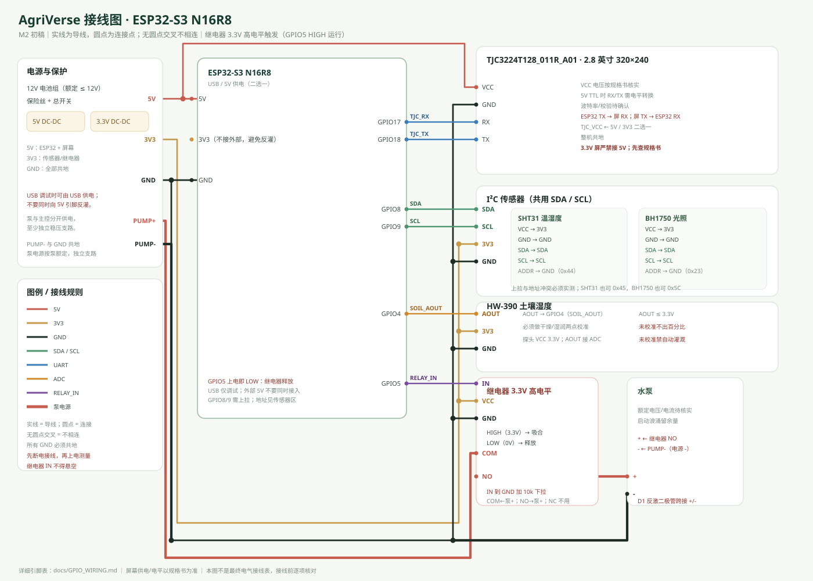

# GPIO 接线表（初稿，待实物核对）



> 接线图初稿：`docs/WIRING_DIAGRAM.svg`。图中同名网络表示用导线连接；屏幕供电/电平仍待规格书核实。
>
> 这是软件默认配置，不是最终电气接线表。正式接线前必须核对开发板原理图、启动引脚与外设冲突。

| GPIO | 连接 | 方向 / 模式 | 说明 |
|---:|---|---|---|
| 4 | HW-390 AOUT | ADC 输入 | 土壤湿度模拟量；ADC1 |
| 8 | SHT31 / BH1750 SDA | I²C 数据 | 需要上拉（模块自带或外部） |
| 9 | SHT31 / BH1750 SCL | I²C 时钟 | 需要上拉 |
| 17 | TJC 屏幕 RX | UART TX（ESP32 发） | 屏幕接收 |
| 18 | TJC 屏幕 TX | UART RX（ESP32 收） | 屏幕发送；注意交叉 |
| 5 | 继电器 IN | 数字输出 | **3.3V 高电平触发**；HIGH 泵运行，LOW 停止 |

## 继电器接线

```text
ESP32-S3 GPIO5 ──► 继电器 IN
ESP32-S3 GND   ──► 继电器 GND
3.3V 电源      ──► 继电器 VCC（按模块要求）
继电器 COM     ──► 水泵电源正极（按泵规格）
继电器 NO      ──► 水泵正极
水泵负极       ──► 电源负极
```

- 继电器 IN 到 GND 加硬件下拉（例如 10kΩ），确保 ESP32 复位/高阻时保持 LOW。
- 水泵回路使用 COM/NO，不使用 NC；继电器掉电时触点释放。
- 继电器线圈与水泵不得由 GPIO 供电。
- 若模块 IN 内部已有上拉，必须先解决冲突，不能只靠软件初始化。

## 屏幕接线

```text
ESP32-S3 GPIO17 (TX) ──► TJC RX
ESP32-S3 GPIO18 (RX) ◄── TJC TX
GND 共地
```

- 屏幕供电按规格书；不要假定 5V 供电与 3.3V TTL 电平一定兼容。
- 波特率、校验、停止位需按屏幕工程与 Wiki 确认；当前固件尚未启用 UART 屏幕任务。

## 安全验证

1. 断开水泵，只接继电器，万用表测量 IN 与触点状态。
2. 上电、复位、拔 USB、程序卡死时 IN 必须为低、触点释放。
3. 接泵前测量泵额定电流与启动浪涌，确认继电器触点余量。
4. 仅在完成以上步骤后接入水泵，并保持最长运行时间保护。
