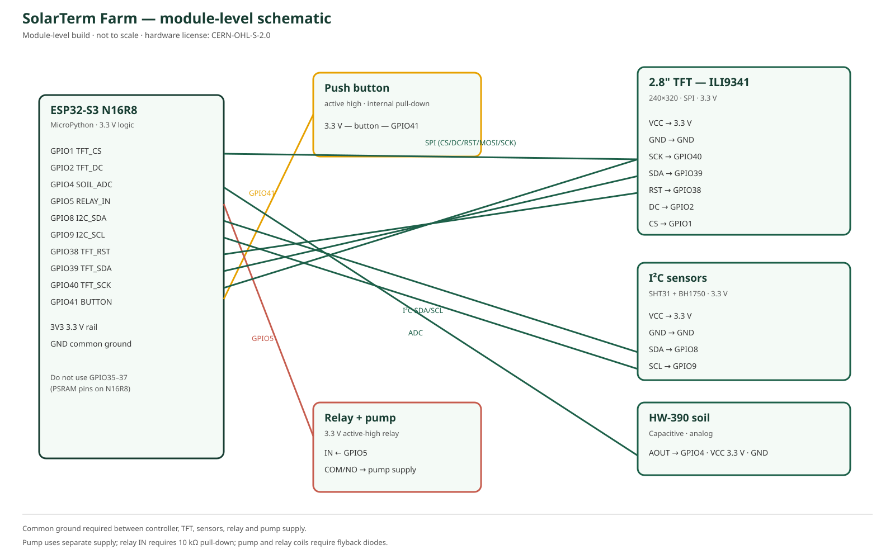

# 模块级原理图

源文件：[SCHEMATIC.svg](SCHEMATIC.svg)

> 这是 **module-level design source**，不是定制 PCB 原理图。它描述现成模块之间的电源、地、SPI、I²C、ADC、按钮和继电器连接，足以复现整机。
>
> 硬件设计源使用 [CERN-OHL-S-2.0](../LICENSE-HARDWARE)。

## 网络表

| 网络 | 连接 | 说明 |
|---|---|---|
| 3V3 | ESP32 3V3、TFT VCC、SHT31 VCC、BH1750 VCC、HW-390 VCC、继电器 VCC | 3.3V 逻辑/显示电源 |
| GND | 所有模块 GND、泵电源负极 | 单点/星形共地 |
| TFT_SCK | GPIO40 → TFT SCK | SPI 时钟 |
| TFT_MOSI | GPIO39 → TFT SDA | SPI 数据 |
| TFT_RST | GPIO38 → TFT RST | 复位 |
| TFT_DC | GPIO2 → TFT DC | 数据/命令 |
| TFT_CS | GPIO1 → TFT CS | 片选 |
| I2C_SDA | GPIO8 ↔ SHT31/BH1750 SDA | 需要上拉 |
| I2C_SCL | GPIO9 ↔ SHT31/BH1750 SCL | 需要上拉 |
| SOIL_ADC | GPIO4 ← HW-390 AOUT | 0–3.3V 模拟量 |
| BUTTON | GPIO41 ← 按钮 → 3.3V | 高电平按下；内部下拉 |
| RELAY_IN | GPIO5 → 继电器 IN | HIGH 吸合；10k 下拉 |
| PUMP | 继电器 COM/NO → 泵电源 | 独立泵电源 |

## 安全

- 继电器 IN 加 10kΩ 下拉，确保复位/高阻时泵关闭。
- 泵和继电器线圈加续流二极管。
- TFT 供电加 100nF + 470µF；SPI 线尽量短。
- 泵电源与主控电源分开，必须共地。
- 详细装配见 [ASSEMBLY.svg](ASSEMBLY.svg) 和 [WIRING.md](WIRING.md)。
