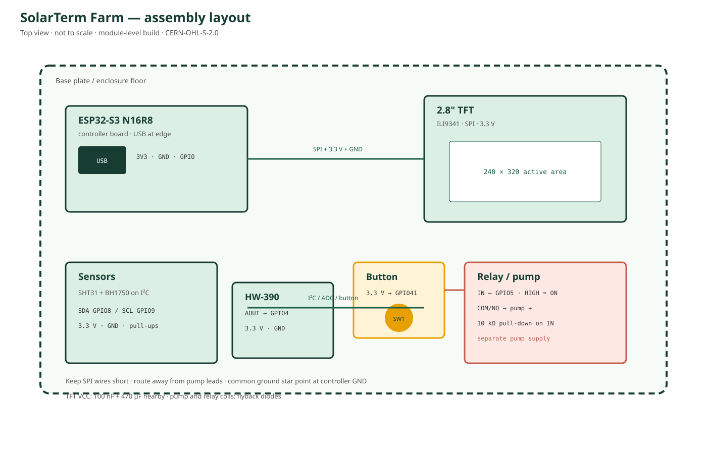

# 接线与装配

> 硬件设计文档使用 CERN-OHL-S-2.0；软件使用 MIT。完整引脚表见 [../docs/GPIO_WIRING.md](../docs/GPIO_WIRING.md)。原理图见 [SCHEMATIC.md](SCHEMATIC.md)，第三方资料见 [DATASHEETS.md](DATASHEETS.md)。

## 1. 接线总表

| 模块 | 引脚 | 连接到 | 说明 |
|---|---|---|---|
| ESP32-S3 | 3V3 | 3.3V 电源 | 主控与传感器 |
| ESP32-S3 | GND | 公共地 | 所有模块共地 |
| TFT | VCC | 3.3V | 按模块规格；不要 5V 逻辑 |
| TFT | GND | GND | 共地 |
| TFT | SCK | GPIO40 | SPI 时钟 |
| TFT | SDA | GPIO39 | SPI MOSI |
| TFT | RST | GPIO38 | 复位 |
| TFT | DC | GPIO2 | 数据/命令 |
| TFT | CS | GPIO1 | 片选 |
| SHT31 | VCC / GND | 3.3V / GND | I²C |
| SHT31 | SDA / SCL | GPIO8 / GPIO9 | 与 BH1750 共用 |
| BH1750 | VCC / GND | 3.3V / GND | I²C |
| BH1750 | SDA / SCL | GPIO8 / GPIO9 | 地址不要冲突 |
| HW-390 | VCC / GND | 3.3V / GND | 电容式 |
| HW-390 | AOUT | GPIO4 | ADC |
| 按钮 | 一端 | 3.3V | 高电平触发 |
| 按钮 | 另一端 | GPIO41 | 内部下拉 |
| 继电器 | VCC / GND | 3.3V / GND | 按模块要求 |
| 继电器 | IN | GPIO5 | HIGH 吸合 |
| 继电器 | COM | 泵电源正极 | 常开回路 |
| 继电器 | NO | 泵正极 | 不使用 NC |
| 泵 | 负极 | 泵电源负极 | 与主控共地 |

## 2. 装配顺序

1. 断电，先只连接 ESP32-S3、TFT 和传感器；
2. 上电确认 TFT 显示、I²C 扫描能看到 SHT31/BH1750；
3. 连接按钮，确认 GPIO41 空闲为低、按下为高；
4. 只连接继电器，不接水泵；测量 IN 为低时触点释放；
5. 给继电器 IN 加 10k 下拉，确认复位/拔 USB 时泵不会启动；
6. 连接泵电源、续流二极管和 COM/NO；
7. 先短时间测试，再逐步增加运行时间。

## 3. 电源与干扰

- TFT 与 ESP32 使用稳定 3.3V；TFT 背光电流较大时使用独立 LDO。
- 泵使用独立电源，不能从 ESP32 的 3.3V 稳压器取电。
- 泵和继电器线圈加续流二极管；必要时加 RC 吸收。
- TFT VCC 附近加 100 nF，电源入口加 470 µF。
- TFT RST 加 10k 上拉到 3.3V，减少泵启动时的复位干扰。
- SPI 线尽量短，GND 使用粗线或多点连接。

## 4. 安全验收

- [ ] 上电、复位、拔 USB 时继电器 IN 为低，泵不启动
- [ ] 继电器 COM/NO 正确，未使用 NC
- [ ] 泵电源与主控共地可靠
- [ ] 续流二极管方向正确
- [ ] 最长运行时间保护有效
- [ ] 按钮与 Web/MCP 均不能绕过 `IrrigationController`
